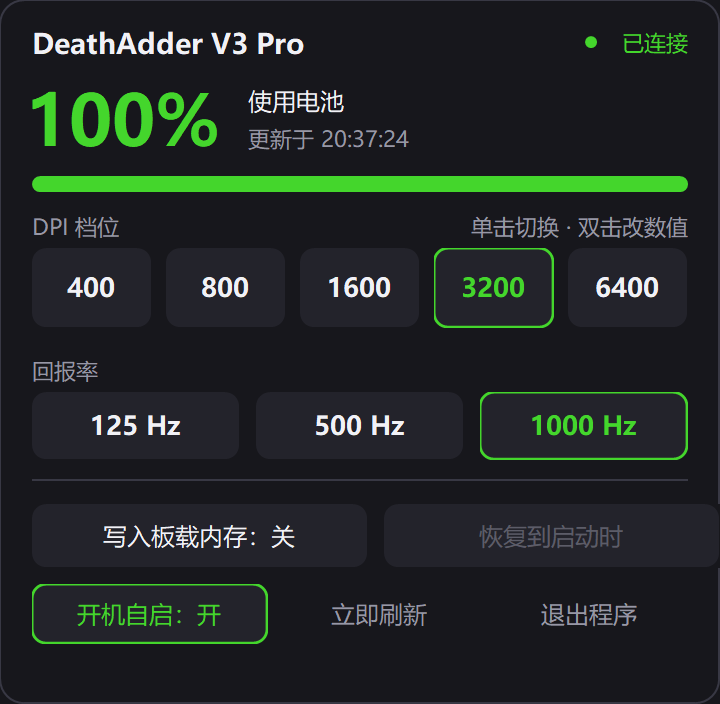

# 雷蛇鼠标控制器

[](https://github.com/chuzhongzai/razer-mouse-controller/actions/workflows/build.yml)

<p align="center">
  
</p>

<p align="center"><sub>由 <b>DeepSeek-V4.1-Flash-1017</b> 在 <b>DeepSeek Harness</b> 上完成</sub></p>

给 **Razer DeathAdder V3 Pro** 写的一个 Windows 托盘小工具：**不装 Synapse、不装驱动、单文件 82 KB**，就能看电量、切 DPI 档位、改回报率、开开机自启。



鼠标颜色是绿的，界面就跟着绿：电量、当前 DPI 档、当前回报率都用一滴 `#44D62C` 标出来。

## 它能做什么

| 功能 | 说明 |
|---|---|
| 电量与充电状态 | 托盘图标本身就是电量表（填满程度 = 电量，充电时画闪电），后台每 30 秒读一次、充电中 15 秒；面板一弹出立刻重读 |
| 低电量提醒 | 掉到阈值（默认 20%，可配）弹一次气泡 + 图标转橙，掉到 5% 转红；回血 10 个百分点才重新武装，不会在阈值上反复抖 |
| DPI 档位 | 5 档，**单击切换、双击直接改数值**；档位表在启动时从鼠标里读，不是写死的 |
| 回报率 | 125 / 500 / 1000 Hz 三档（HyperPolling 8K 的写法在协议里留了，本机没验证） |
| 悬停看状态 | 鼠标停在托盘图标上，弹一个两行文字气泡：`雷蛇鼠标 · 96% · 充电中` / `3200 DPI · 1000 Hz · 第 4 档`；指针一移开立刻消失 |
| 开机自启 | 面板上直接有开关，写的是 `HKCU\...\Run`，不需要管理员权限 |
| 退出还原 | 可选：退出时把 DPI / 回报率恢复成启动时读到的值，免得动过别人手感 |


## 为什么不用 Synapse

- **体积**：Synapse 装完是几百 MB 常驻三个服务；这个是 82 KB 的单 exe，用系统自带的 .NET Framework 4.8，不需要另装运行时。
- **后台开销**：一次电量查询约 130 ms（两条 HID 命令，每条等 60 ms 设备响应），30 秒一次 → 设备占用约 0.4%。
- **原理简单**：走的是鼠标自己的 HID Feature Report 协议（91 字节报文 + XOR 校验），三个 Win32 API 就够：`CreateFileW` / `HidD_SetFeature` / `HidD_GetFeature`。协议细节全部记在 [`protocol.md`](protocol.md)。

## 下载

到 [Releases](https://github.com/chuzhongzai/razer-mouse-controller/releases) 下 `RazerMouse.exe`，双击就能用（Windows 10/11，x64）。第一次运行会在托盘出现一个电池图标。

> 如果 Windows 提示"已保护你的电脑"，点"更多信息 → 仍要运行"；这是没签名的正常现象。

## 从源码编译

不需要 Visual Studio，也不需要 .NET SDK —— 用系统自带的 C# 编译器：

```powershell
cd razer-mouse-controller
./build.ps1            # 产出 bin\RazerMouse.exe 和 bin\RazerMouseTest.exe
./build.ps1 -Launch    # 编译完直接启动
```

`build.ps1` 调的是 `C:\Windows\Microsoft.NET\Framework64\v4.0.30319\csc.exe`（.NET Framework 4.8，Win10 1809 以后都自带）。

自检（只读，不改鼠标任何设置）：

```powershell
bin\RazerMouseTest.exe --selftest    # 序列号/固件/电量/DPI/回报率/档位表
bin\RazerMouseTest.exe --alerttest   # 14 条低电量提醒判定断言
```

## 实测过的三件事

1. **DPI 档位表可以从鼠标里读出来**：`0x04 / 0x86` 回 38 字节，`[当前档, 档数, (序号, X高, X低, Y高, Y低, 0, 0) × 5]`。坑是回包里的 `data_size` 字段只是请求的回显，必须固定取 `b[9..46]`。
2. **写通道是通的**：DPI（`0x04/0x05`）、回报率（`0x00/0x05`）、档位表（`0x04/0x06`）三条都做过"把当前值原样写回 → 读回比对一致"，鼠标设置全程没变。
3. **4K 200% 缩放下不糊**：程序带 DPI 感知清单，所有尺寸都按真实 DPI 换算，不是把 360×352 的位图放大两倍。

更多踩坑记录在 [`protocol.md`](protocol.md)（报文/时序/状态码）和 [`research/device-notes.md`](research/device-notes.md)（设备身份、原始回包、电量刻度坑、能力边界）。

## 用不了的功能（别再花时间）

- **按键重映射 / 宏**：HID 协议里没有"改按键功能"的通用命令，那是软件层鼠标钩子的活。
- **多套板载配置**：DA V3 Pro 只有 **1 组**板载内存，"多套"只能存在程序里、切换时重新下发。
- **固件升级**：Razer 只对自家签名的升级包开这条路。
- **灯效**：协议里有（`0x03` 系列），但这一版没做界面。

## 文档

| 文件 | 内容 |
|---|---|
| [`使用说明.md`](使用说明.md) | 面向使用者：怎么用、界面每个按钮、配置文件、命令行参数、FAQ |
| [`protocol.md`](protocol.md) | 91 字节报文结构、CRC、时序、状态码、完整命令表 |
| [`PLAN.md`](PLAN.md) | 设计取舍：为什么 C# WinForms、为什么托盘 + 弹出面板、四个阶段的验收标准 |
| [`research/device-notes.md`](research/device-notes.md) | 设备身份、实测原始回包、电量刻度、能力边界 |
| [`research/phase0_readonly_probe.md`](research/phase0_readonly_probe.md) | 阶段 0 的 35 条只读探测记录 |
| [`samples/`](samples) | 零依赖的 Python / PowerShell 客户端，先跑通再改代码 |
| [`tools/`](tools) | 调试用的 UI 探针脚本 |

## 目录结构

```
src/Native/       HID 枚举与 Feature Report 读写（SetupAPI + hid.dll）
src/Protocol/     91 字节报文、CRC、命令封装（电量/DPI/回报率/档位表）
src/App/          后台线程、配置、低电量判定、开机自启、离屏渲染
src/Ui/           无边框深色窗口、自绘胶囊按钮、托盘图标绘制、悬停气泡
build.ps1         csc 编译脚本
```

## 谁做的

<p align="left">
  
</p>

这个工程是 **AI 写的**：从只读探测设备、写 91 字节报文层、画深色界面，到 4K/DPI 适配、修 bug、发版，全部由 **DeepSeek-V4.1-Flash-1017** 在 **DeepSeek Harness** 上完成。

| | |
|---|---|
| 模型 | DeepSeek-V4.1-Flash-1017（1017 是模型版本号，不是日期） |
| 运行环境 | DeepSeek Harness（Windows 沙箱、实时终端与文件通道） |
| 协作方式 | 人定需求与验收，AI 探测协议、写代码、跑真机验证 |
| 鲸鱼娘形象 | 图片来源：[aigengtu.com/zh/meme/1050](https://aigengtu.com/zh/meme/1050)（仅作项目吉祥物） |

## 许可

仓库目前没有附许可证文件。想拿去改或再分发，开个 issue 说一声即可。
